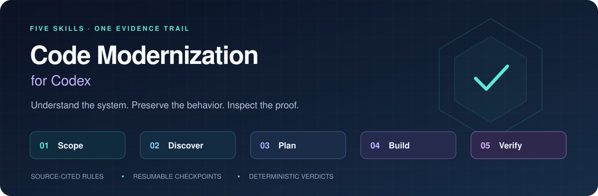
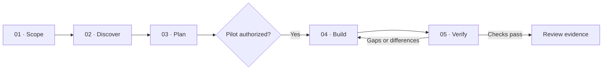

<div align="center">



# Code Modernization for Codex

**Five skills for moving legacy software forward with evidence you can inspect.**

[](https://github.com/dpolishuk/codex-code-modernization/actions/workflows/ci.yml)
[](#requirements)
[](LICENSE)
[](plugins/code-modernization-codex/plugin.json)

[Quick start](#quick-start) · [Five skills](#the-five-skills) · [Verification](#how-verification-works) · [Demo](#try-the-demo) · [Contributing](#contributing)

</div>

Turn a legacy codebase into a scoped migration: understand what it does, capture
its business rules, agree on a pilot, implement it, and compare its behavior with
the original. Keep the plan, decisions, raw test results, and verification report
on disk so the next chat can continue from evidence.

This is an independent Codex adaptation of Anthropic's
[Code Modernization plugin](https://github.com/anthropics/claude-plugins-official/tree/8f814f49002ff824e8a9ba43cf96112dc7f5948d/plugins/code-modernization).
It reuses the upstream proof engine and adds Codex skills, content-hash checkpoints,
plan-bound authorization records, and an HTML report.

> **Early release:** the package, executable fixture, and fresh-chat skill discovery
> have been tested. A real repository migration has not yet been validated with
> this adaptation. `PROVEN` is a verdict about recorded checks and inputs.

## Quick start

### Install from GitHub

In a Codex CLI version with plugin commands:

```sh
codex plugin marketplace add dpolishuk/codex-code-modernization
codex plugin add code-modernization-codex@modernization-local
```

Start a **fresh Codex chat**, select the `modernize` skill, and provide your paths:

```text
Use $code-modernization-codex:modernize to assess /absolute/path/to/source.
Store artifacts in /absolute/path/to/separate-migration-workspace.
Understand and plan only. Start with one module and preserve existing behavior.
```

Choose a workspace outside the legacy source tree. You can authorize the concrete
pilot after reviewing the plan.

<details>
<summary><strong>Install from a local checkout in the desktop app</strong></summary>

```sh
git clone https://github.com/dpolishuk/codex-code-modernization.git
cd codex-code-modernization
```

Open the checkout as a Codex project and trust it when prompted. In Plugins, choose
the **Local Code Modernization** marketplace and install `code-modernization-codex`.
Refresh or restart the app if the marketplace is not visible, then start a fresh
chat. Installation uses a cached copy; refresh/reinstall after editing the source.

The catalog is `.agents/plugins/marketplace.json`. The project configuration enables
the plugin after installation. Available commands and local-marketplace behavior
depend on the Codex client; see the [official packaging guide](https://developers.openai.com/plugins/build/plugins).

</details>

## The five skills

All names below use the prefix `$code-modernization-codex:`.

| Skill | What it does | What you keep |
| :--- | :--- | :--- |
| **`modernize`** | Captures intent, selects a track, or resumes work | Scope, baseline hashes, current status |
| **`modernize-discover`** | Assesses the system and traces dependencies and business rules | Source-cited rule cards, topology, risks |
| **`modernize-plan`** | Defines a small pilot and measurable acceptance criteria | Phased brief and actual user decisions |
| **`modernize-build`** | Implements the authorized slice and collects development evidence | Replacement code, tests, comparison cases |
| **`modernize-verify`** | Reruns checks and computes a scoped verdict | Raw results, per-module proof, HTML report |



### Three migration tracks

| Track | Use it for | Example |
| :--- | :--- | :--- |
| **Uplift** | A newer version of the same technology | Upgrade a runtime or framework |
| **Transform** | A rewrite in another stack | Replace one legacy module in a new language |
| **Reimagine** | A change in architecture | Extract a service with explicit compatibility boundaries |

Understand-only work stops after the plan. Existing authorization is reused when
it covers the current scope; a changed plan cannot silently inherit approval.

## How verification works

The model runs the experiments and collects evidence. The **Python proof engine
computes the verdict** from saved results.

1. **Tests actually ran.** Parse runner XML or raw logs; typed pass counts are not proof.
2. **Critical rules have coverage.** Trace rule IDs to tests that executed and passed.
3. **Old and new agree.** Compare outputs on the same inputs, with declared masks and tolerances.
4. **Fresh inputs also agree.** Test new cases outside the development examples.
5. **Tests notice a defect.** A deliberate change in a scratch copy must cause failures.
6. **The baseline stays intact.** Check source drift; uplifts add baseline and test-preservation checks.

The Codex adapter also hashes stage inputs, invalidates stale checkpoints, binds
authorization to the current plan, and checks that verification evidence comes
from the independent run window.

| Verdict | Meaning |
| :--- | :--- |
| **PROVEN** | All required checks passed for the recorded scope |
| **PARTLY PROVEN** | No failing check, but evidence or coverage is incomplete |
| **NOT PROVEN** | A required check failed or no meaningful execution occurred |

The original verdict stays in `VERIFICATION.json`. The adapter's effective verdict
is in `CODEX_VERIFICATION.json` and can be stricter. `REPORT.html` combines current
status and evidence in a readable, self-contained page.

Read the [evidence formats and procedure](plugins/code-modernization-codex/references/verification.md)
or the [checkpoint and workspace contract](plugins/code-modernization-codex/references/workflow.md).

## Try the demo

Run the tooling without installing the plugin or making any model calls:

```sh
git clone https://github.com/dpolishuk/codex-code-modernization.git
cd codex-code-modernization

python3 -B plugins/code-modernization-codex/scripts/validate_package.py
python3 -B plugins/code-modernization-codex/scripts/demo.py --output ../modernization-demo
```

Use a **new output directory** for each demo run. The fixture executes two tiny
Python implementations, three unit tests, two development comparisons, twelve
fresh comparisons, and a deliberately failing canary. Open:

```text
../modernization-demo/workspace/analysis/demo/REPORT.html
```

No API key, database, network access, or third-party Python dependency is required
for this demo.

## Requirements

- **Codex** with local plugin and skill support.
- **Python 3.9+** for the adapter and proof helpers; standard library only.
- **Your target toolchains** to build and execute an actual migration.
- **Node.js**, optionally, for the retained upstream HTML/report regression tests.

The package includes no MCP server, lifecycle hooks, telemetry, or separate agent
runtime. Work is sequential by default; delegation is bounded and requires the
user's authorization.

## Tested, with boundaries

The local validation recorded **279 passing tests**: 259 retained upstream tests
and 20 adapter tests. A fresh Codex chat advertised all five installed skills,
read their references, and passed package validation. CI repeats the executable
checks; it does not authenticate to Codex or run model-driven migrations.

See the [validation record](VALIDATION.md) and [machine-readable results](VALIDATION.json).

- A symlink to legacy source is **not write protection**. Use disposable build
  copies and OS-level isolation when needed.
- Local hashes detect drift; editable files are **not tamper-proof attestation**
  or authenticated signatures.
- Generated-directory exclusions and nested symlinks limit content checking;
  the exact policy is documented in the workflow reference.
- The upstream fresh-output uniqueness heuristic can be unsuitable for constant
  or Boolean-output systems. Report the limitation instead of manufacturing evidence.
- Passing local checks does not establish universal equivalence, production
  readiness, or human acceptance.

## Repository layout

```text
.agents/plugins/marketplace.json       Local/Git marketplace catalog
.github/workflows/ci.yml              Package, regression, and demo checks
plugins/code-modernization-codex/
├── plugin.json                       Portable plugin manifest
├── .codex-plugin/plugin.json         Codex compatibility manifest
├── skills/                           The five entry points
├── references/                       Workflow and evidence contracts
├── scripts/                          State adapter, demo, package validator
├── tests/                            Adapter regression tests
├── vendor/upstream/                  Unmodified helpers, tests, and assets
└── UPSTREAM.json                     Pinned revision and SHA-256 hashes
```

## Contributing

Small pilots and reproducible failure cases are especially useful. Describe the
expected behavior, the observed result, and the smallest sanitized fixture that
demonstrates the difference.

Run these checks before opening a pull request:

```sh
python3 -B plugins/code-modernization-codex/scripts/validate_package.py
python3 -B -m unittest discover -s plugins/code-modernization-codex/tests -v
python3 -B -m unittest discover -s plugins/code-modernization-codex/vendor/upstream/scripts/tests
```

Keep vendored files unchanged. Adapt behavior in the Codex layer and add a focused
regression test. When intentionally upgrading upstream, update the pinned revision,
hashes, attribution, and validation evidence together. Never include credentials,
production data, or private source code in fixtures or issue reports.

## Credits and license

Maintained by [Dmitry Polishuk](https://github.com/dpolishuk).

Built on [Anthropic Code Modernization](https://github.com/anthropics/claude-plugins-official/tree/8f814f49002ff824e8a9ba43cf96112dc7f5948d/plugins/code-modernization),
pinned at `8f814f49002ff824e8a9ba43cf96112dc7f5948d`. Eighteen upstream files are
preserved byte-for-byte; provenance is recorded in
[UPSTREAM.json](plugins/code-modernization-codex/UPSTREAM.json).

[Apache-2.0](LICENSE). See [NOTICE](NOTICE) for attribution and the bundled
[Mermaid license](plugins/code-modernization-codex/vendor/upstream/assets/vendor/LICENSE-mermaid.txt).
This project is not affiliated with or endorsed by OpenAI or Anthropic.
